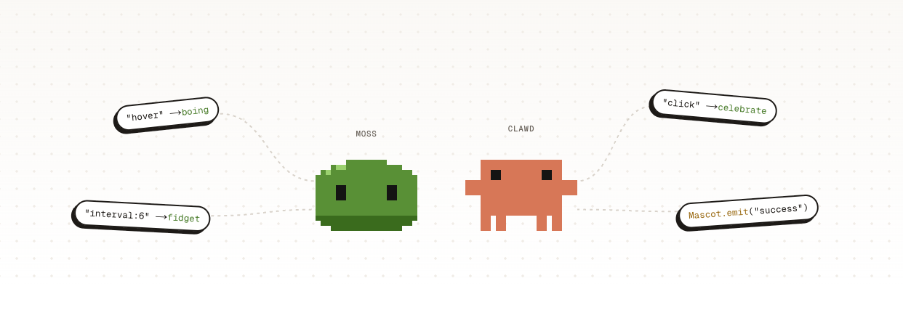

<div align="center">



# OpenMascot

**Pixel mascots for any website.** Draw a character, give it moves, and let it react to your users.

[](https://www.npmjs.com/package/openmascot)
[](https://www.npmjs.com/package/openmascot)
[](LICENSE)

[Website](https://openmascot.com/) · [Studio](https://studio.openmascot.com/) · [Docs](#docs) · [Npm](https://www.npmjs.com/package/openmascot)

</div>

---

OpenMascot is an open-source studio for drawing small pixel characters, plus a tiny runtime ([`openmascot`](https://www.npmjs.com/package/openmascot), about 3 KB gzipped, no dependencies) that puts them on any site. A mascot is a single JSON file, so there's no account and no server, and it works anywhere.

## Getting started

### 1. Make

Open the [studio](https://studio.openmascot.com/) and draw your character on a 24 × 16 pixel board, or start from a sample (**Clawd** or **Moss**). Add poses such as `look-left`, `blink` or `arms-up`.

### 2. Animate

Turn poses into moves (a wave, a hop, a happy dance), then choose what plays them: page load, a click, a hover, a timer, or a custom event from your own code.

### 3. Share

Download the mascot's JSON from the **Share** step and add it to your site.

**React**

```bash
npm install openmascot
```

```tsx
import { Mascot, emit } from "openmascot/react";
import moss from "./moss.json";

export const App = () => (
  <>
    <Mascot doc={moss} position="bottom-right" />
    <button onClick={() => emit("success")}>Save</button>
  </>
);
```

It needs React 19 and works with server rendering, including Next.js.

<details>
<summary><b>Script tag</b></summary>

Put the JSON next to your page, then add:

```html
<script src="https://cdn.jsdelivr.net/npm/openmascot@0" defer></script>
<open-mascot src="/moss.json" position="bottom-right"></open-mascot>

<script>
  Mascot.emit("success");
</script>
```

</details>

## Docs

### Options

| `<Mascot>` prop    | `<open-mascot>` attribute | What it does                                                                       |
| ------------------ | ------------------------- | ---------------------------------------------------------------------------------- |
| `doc`              | (property)                | The mascot JSON as an object.                                                      |
| `src`              | `src`                     | URL of the mascot JSON, used when there's no `doc`.                                |
| `position`         | `position`                | `"bottom-right"` or `"bottom-left"` pins it to a corner. Omit it to render inline. |
| `scale`            | `scale`                   | Screen pixels per mascot pixel. Default `4`.                                       |
| `name`             | `name`                    | A handle for targeting this mascot from code.                                      |
| `triggers={false}` | `triggers="off"`          | Turns off load, click, hover and timer triggers.                                   |

### Triggers

Set these in the studio. Each one plays a move once, and then the mascot rests on its `default` pose.

| Trigger          | Fires when                        |
| ---------------- | --------------------------------- |
| `load`           | The mascot appears on the page.   |
| `click`          | The mascot is clicked.            |
| `hover`          | The pointer enters the mascot.    |
| `interval:<sec>` | Every `<sec>` seconds.            |
| `custom:<name>`  | Your code calls `emit("<name>")`. |

### Playing moves from code

```ts
import { emit, play } from "openmascot/react"; // script tag: Mascot.emit, Mascot.play

emit("success"); // fire the "success" trigger on every mascot
play("wave"); // play the move named "wave"
emit("success", { to: "inbox" }); // only the mascot with name="inbox"
```

Both return `true` if a mascot played something. To control one mascot, call `play()`, `emit()`, `pause()` or `resume()` on its element (or its ref in React).

## Development

You need Node 24 and pnpm 10.

```bash
pnpm install
pnpm dev        # studio on http://localhost:3000
pnpm dev:site   # landing page on http://localhost:3001
pnpm check      # typecheck, lint and format
```

## Contributing

Issues and pull requests are welcome. Commits follow [Conventional Commits](https://www.conventionalcommits.org), and please run `pnpm check` and `pnpm test` before opening a PR.

## License

[MIT](LICENSE) © Dheeraj Mahra

Clawd is a trademark of Anthropic, PBC. OpenMascot is not affiliated with Anthropic.
