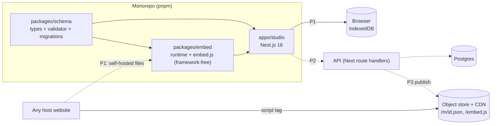

# OpenMascot: High-Level Design

Status: draft for review. Scope: system shape, boundaries, phasing, and the mascot document schema. Not covered: UI detail (see the wireframes), API endpoints, infra sizing.

## 1. What we're building

A studio where anyone draws a pixel character, gives it moves, and embeds it on any page with one script tag and one JSON file. The runtime is the product's core; the studio is how mascots get made.

Phasing (decided):

| Phase | Scope                                                     | Persistence     |
| ----- | --------------------------------------------------------- | --------------- |
| 1     | Studio polish: Start, Make, Animate, Share. Local only.   | Browser         |
| 2     | Login, saved library in the cloud, community/gallery      | Server DB       |
| 3     | Hosted embed (CDN-served mascot, snippet with an id only) | Server DB + CDN |

Phase 1 is built so phases 2 and 3 are additive: no rewrite of the document format or the runtime.

## 2. System context



Solid = phase 1, dashed = later.

## 3. Components and boundaries

**`packages/schema` (new).** The single source of truth for the mascot document: TypeScript types, a runtime validator, a `migrate(doc)` function, and limits (max grid, max poses). Used by the studio (import, autosave), the API (phase 2), and a CLI/CI check. It depends on nothing. The embed runtime imports only the types, so validation code never ships in `embed.js`.

**`packages/embed`.** Framework-free runtime. `MascotPlayer` renders to a canvas, plays sequences, wires triggers. Exposes a script-tag API (`data-mascot`, `Mascot.play/emit`) and an ESM export. Rules: no dependencies, no `innerHTML`, treats the doc as untrusted data (clamps and ignores unknown fields, never throws on a bad pose). Size budget target: under 6 KB gzipped.

**`apps/studio`.** Next.js 16 app. Client-heavy: editor state is a reducer (`mascot-store`) with undo history; previews go through the real runtime so what you see is what ships. Server-rendered only for the shell; there is no server dependency in phase 1.

**Persistence boundary.** Studio talks to a `MascotRepository` interface, never to `localStorage` directly:

```ts
interface MascotRepository {
  list(): Promise<MascotSummary[]>; // id, name, updatedAt, thumbnail
  get(id: string): Promise<MascotDoc | null>;
  save(doc: MascotDoc): Promise<void>;
  remove(id: string): Promise<void>;
}
```

Phase 1 implements it on IndexedDB. Phase 2 adds an HTTP implementation and a sync wrapper (local-first: write locally, push when signed in). Studio components never change.

**API and hosting (phase 2/3).** Next route handlers over Postgres, plus object storage and CDN for published mascots. Deliberately not designed further here.

## 4. Key decisions

| #   | Decision                                                                                                   | Why                                                                                               | Revisit when                                                 |
| --- | ---------------------------------------------------------------------------------------------------------- | ------------------------------------------------------------------------------------------------- | ------------------------------------------------------------ |
| D1  | Mascot is one self-contained JSON document; the doc is the unit of storage, export, embed, and sharing     | Matches the "one JSON file" promise; trivially portable between local, DB, and CDN                | Never; it is the product                                     |
| D2  | `packages/schema` owns the format; embed imports types only                                                | One definition, no validator bloat in the runtime                                                 | Only if we add non-TS consumers (then publish a JSON Schema) |
| D3  | Studio persists through `MascotRepository`; phase 1 uses IndexedDB, not `localStorage`                     | Start page needs a multi-mascot library with thumbnails; `localStorage` is single-key, 5 MB, sync | Phase 2 adds the remote implementation                       |
| D4  | Local-first in phase 2: cloud is a sync target, not the primary store                                      | Phase 1 users keep their work when accounts arrive (import local mascots on first login)          | If realtime collaboration becomes a goal                     |
| D5  | Embed renders via canvas from data; mascot JSON never becomes markup                                       | Removes XSS from community-authored mascots in phase 2                                            | Never                                                        |
| D6  | Published mascots are immutable versions served from a CDN; the snippet can pin a version or follow latest | Embeds on third-party sites must not break when an author edits                                   | Phase 3 design                                               |
| D7  | Monorepo with Next.js route handlers for the API until there is a reason to split                          | One deploy, shared types, minimal ops for a small team                                            | Load or team shape demands a separate service                |

## 5. Mascot schema decisions

The POC's `MascotDoc` is a good base. These are the decisions to lock before we build on it.

### 5.1 Shape (v1)

```jsonc
{
  "schema": 1, // NEW: format version, drives migrate()
  "id": "m_8f2k",
  "name": "Clawd",
  "grid": { "w": 24, "h": 16 },
  "tick": 60, // ms per animation tick
  "palette": ["#141413", "#d77757"], // #rrggbb only
  "poses": { "default": "....11...." }, // w*h chars, "." = transparent
  "sequences": {
    "jump": [{ "pose": "default", "hold": 12, "offset": 0, "x": 0 }]
  },
  "triggers": {
    "load": "jump",
    "click": "jump",
    "interval:30": "wave",
    "custom:success": "celebrate"
  }
}
```

### 5.2 Decisions

**S1. Split format version from revision.** The POC's `version` field is ambiguous. Replace it with `schema` (format version, lives in the doc, drives migrations). Revision history lives outside the doc (`updatedAt` locally, `mascot_versions` rows in phase 2). Migrations run on load and import, and only ever move forward.

**S2. Keep pose strings, one char per cell.** A 24x16 pose is 384 chars and a whole mascot is a few KB. It is compact, diffable, and cheap to rasterize. Cost: palette capped at 36 colors (base-36 index). That is plenty for pixel art; enforce it in the validator and the UI. Do not move to arrays or RLE.

**S3. The grid is fixed at 24x16, always.** Every pose has exactly 384 characters. The validator rejects any doc whose `grid` is not `{ w: 24, h: 16 }` or whose poses are a different length. We keep `grid` in the doc so the format stays self-describing and a future change is a `schema` bump, but there is no user-selectable size. Consequences: one canvas size for the runtime, thumbnails, GIF/PNG export and the embed layout, and a hard ceiling on doc size. Other limits to enforce: up to ~32 poses, ~32 sequences, ~64 frames per sequence, 36 palette entries.

**S4. Palette is data, hex only.** `#rrggbb`, lowercase, validated. No alpha in v1; transparency is the `.` cell. Palette index order is part of the doc, so removing a color means remapping poses (studio does this, not the runtime).

**S5. Sequences stay frame lists with per-frame modifiers.** `pose`, `hold`, `offset`, `x` as today. The "Effects come in a later phase" note in the Animate design is covered by adding optional fields to a frame. Rule: **additive optional fields don't bump `schema`; the runtime ignores what it doesn't know.** Only breaking changes bump it.

**S6. Triggers stay a map, parsed into a typed union in code.** Keys like `interval:30` and `custom:success` are compact and match the "Plays..." UI (one sequence per event). The studio and runtime parse them through one `parseTrigger(key)` in `packages/schema` so the string format lives in exactly one place. Trade-off accepted: no multiple sequences per event and no per-trigger options (cooldown, probability). If we need those, that is a `schema: 2` migration to an array of rules, and the migration is mechanical.

**S7. IDs are client-generated and stable.** `m_` plus a short random id (nanoid-style), created at mascot creation. It never changes across export, import, local, and cloud, so it is the DB primary key later with no remapping. Pose and sequence names are user-facing keys within a doc, unique per doc, constrained to a safe charset (`[a-z0-9-_ ]`, bounded length) so they are safe as keys and in `custom:<name>` triggers.

**S8. Do not normalize poses into rows.** In Postgres (phase 2), store the doc as `jsonb` and denormalize only what we query or list: `owner_id`, `name`, `slug`, `visibility`, `updated_at`, `thumbnail`. Nothing queries individual cells. Published snapshots go in `mascot_versions (mascot_id, rev, doc jsonb, created_at)`, immutable.

**S9. Thumbnails are derived, not authored.** Generated from the `default` pose and stored beside the doc, never inside it, so the doc stays the minimal canonical form.

**S10. Referential integrity is the validator's job.** Sequences may only reference existing poses; triggers only existing sequences; the `default` pose always exists. Every sequence plays once and the mascot then rests on `default`; there is no looping sequence, and an `interval:<seconds>` trigger is how a move repeats. The validator checks it on import, and the runtime degrades safely when it is violated (falls back to the `default` pose, skips the frame).

### 5.3 Phase 2 data sketch (for orientation only)

```
users(id, email, ...)
mascots(id, owner_id, name, slug, visibility, doc jsonb, thumbnail, created_at, updated_at)
mascot_versions(mascot_id, rev, doc jsonb, created_at)      -- published snapshots
gallery/likes/forks: decided in phase 2
```

## 6. Cross-cutting

- **Security.** Docs are untrusted input everywhere: validate on import and on the API, clamp in the runtime (D5). Rate-limit and size-limit uploads in phase 2. Strict CSP-friendly embed (no inline eval, no remote fetch except the mascot JSON).
- **Accessibility.** Runtime honors `prefers-reduced-motion` (already in the POC) and exposes `aria-label` from `name`.
- **Performance.** Rasterize each pose once to an offscreen canvas, then blit per tick. One shared timer per page, not per instance.
- **Testing.** Schema package gets the heaviest tests (validator, migrations, `parseTrigger`). Runtime gets a headless playback test (frame expansion, trigger wiring). Studio is covered by a few end-to-end flows (Start, Make, Animate, Share).
- **Tooling.** pnpm workspaces, Node 24, strict `tsc`, oxlint/oxfmt, conventional commits (already in place).

## 7. Open questions

1. GIF/PNG export stays studio-only (current plan). Confirm it should not move into the embed package.
2. Phase 2 auth provider and DB host are undecided; this HLD only assumes Postgres and a managed auth service.

## 8. Suggested first build steps

1. Extract `packages/schema` from `packages/embed/src/types.ts`: add `schema: 1`, validator, limits, `parseTrigger`, `migrate`.
2. Introduce `MascotRepository` and an IndexedDB implementation; replace `storage.ts`; build the Start page's library on it.
3. Make the studio and embed consume the validator on import and load.
4. Then proceed screen by screen against the wireframes.
